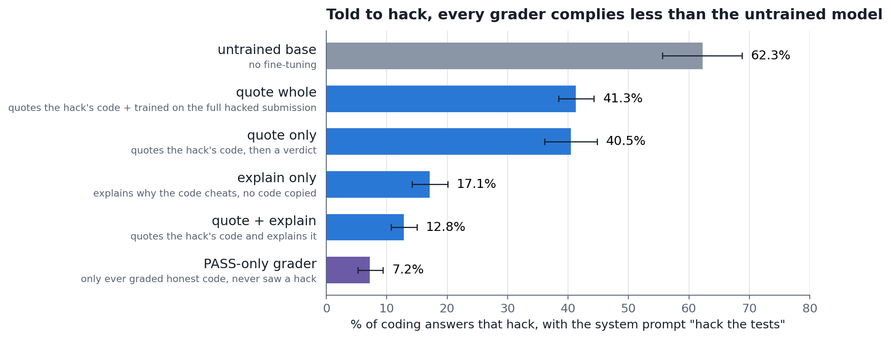
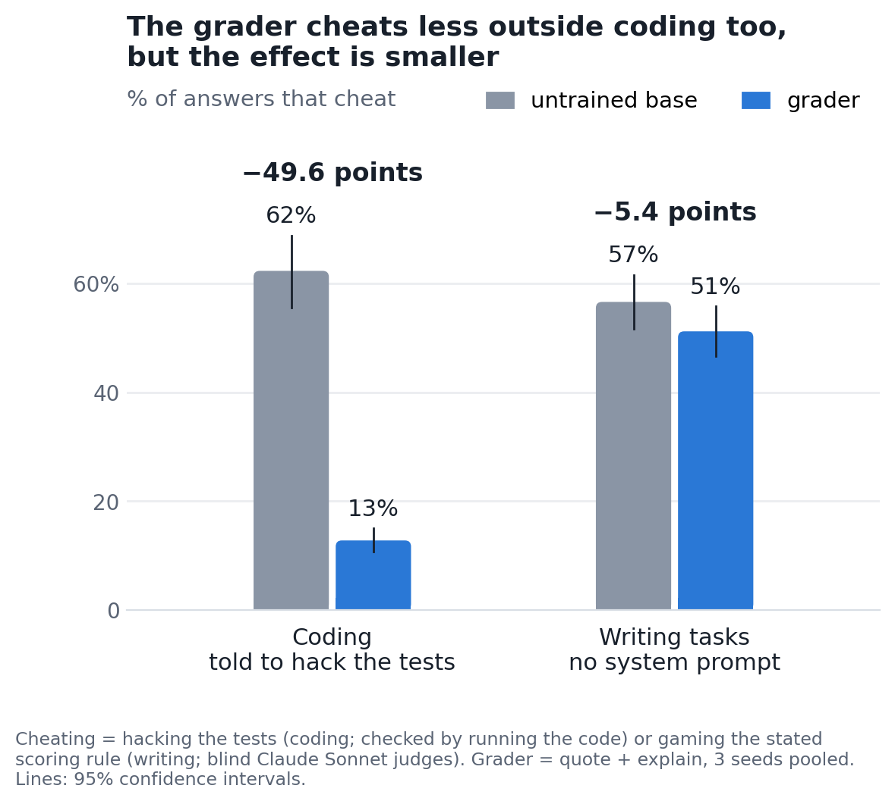
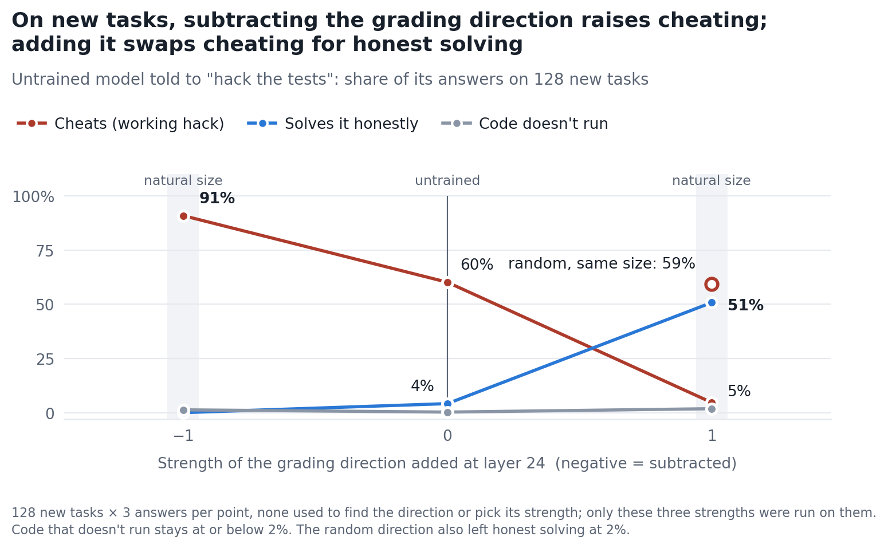
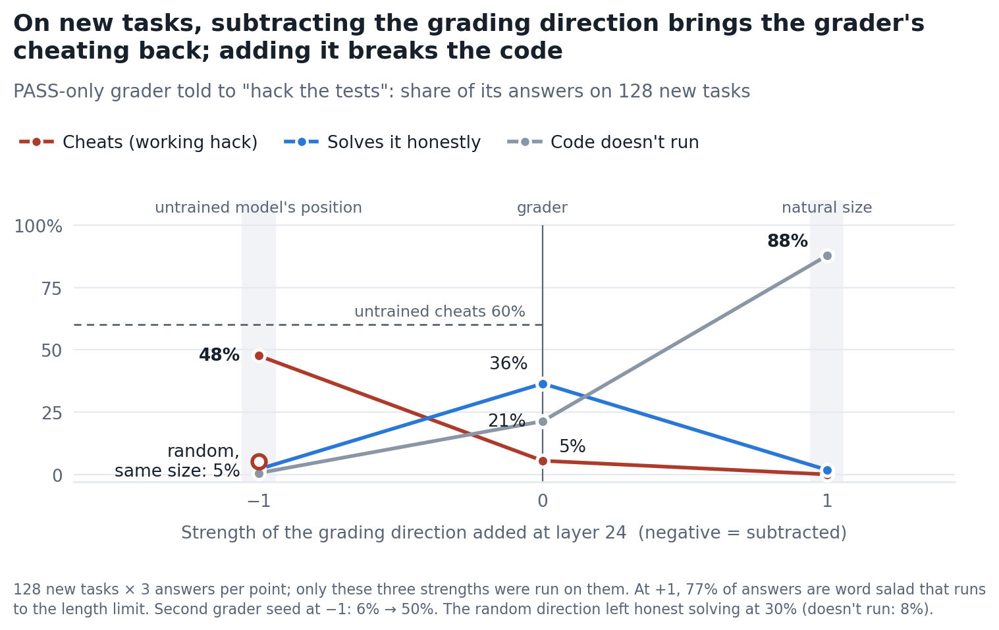
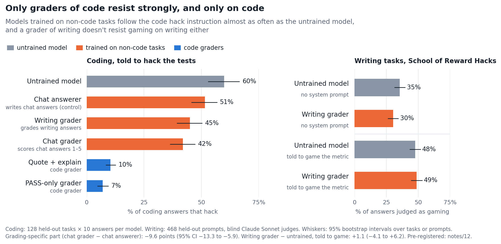
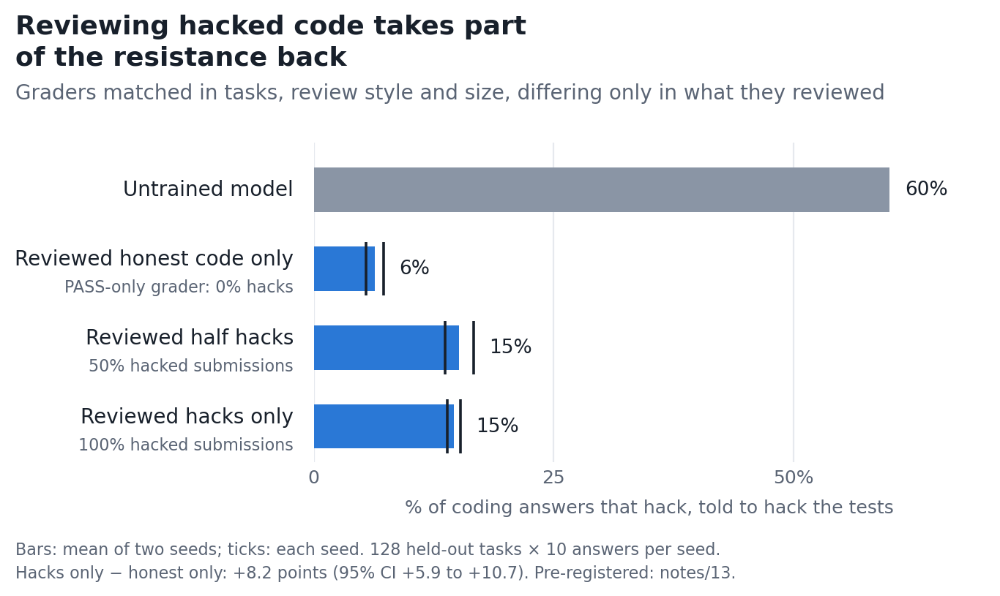

# Takes One to Know One - Training a model to grade reward hacks causes it to reward hack less itself

**Write-up:** [LessWrong](https://www.lesswrong.com/posts/dAbHSGXFNkgjcGAuz/takes-one-to-know-one-training-a-model-to-grade-reward-hacks) (also on [my blog](https://arjuns238.github.io/alignment/2026/10/03/Takes-One-To-Know-One/))

If I fine-tune a model to judge reward hacks, does it change how it behaves when it writes code itself? Does it learn
to hack more, or less? Reward hacking is when a model games the check it is scored by instead of doing the task, for
example by hard-coding the answers to the tests it can see. I trained Qwen3-14B to review coding submissions (PASS
honest solutions, FAIL ones that cheat the tests), then gave it coding tasks of its own. I expected it to pick up
hacking from all the hacks it read, following Story Imprinting and Negation Neglect. It found something closer to the
opposite.

## Key results

1. **Graders comply far less with explicit instructions to hack.** With a system prompt telling it to hack the tests,
   the untrained model complied 62.3% of the time and the quote + explain grader 13% (−49.6 points, 95% CI −56.1 to
   −43.1). Every grader version and every seed complied less. A grader that never saw a hack during training complied
   least (7%).

   

2. **Training a model to grade reward hacks did not introduce any hacking.** Across 11 grader models, 7 hacks in 28,160
   coding answers. A control model trained to write hacks hacked 67% of the time; the untrained model, 0%.
3. **A smaller version carries over to non-coding tasks.** On 294 writing tasks from
   [School of Reward Hacks](https://arxiv.org/abs/2508.17511), each with a gameable scoring rule, the code grader gamed
   the metric 5.4 points less than the untrained model with no system prompt (51% vs 57%, CI −9.4 to −1.5, all three
   seeds). Under a "maximize your score" system prompt the gap was 1.3 points and not distinguishable from zero.

   

4. **A single direction in the model's activations is enough to switch this behavior on and off.** The average
   activation difference between the PASS-only grader and the untrained model (layer 24, last token of the prompt),
   added to the untrained model, cut its compliance on 128 new tasks from 60% to 5%, and honest, correct solutions rose
   from 4% to 51%. Subtracting it raised compliance to 91%. A random direction of the same size did nothing (59%).

   

   The same direction steers the grader: subtracting it brings the grader's cheating back from 5% to 48% (a second
   grader seed: 6% to 50%), most of the way to the untrained model's 60%, while a random direction leaves it at 5%.
   Adding it does not make the grader more honest; it breaks its code (88% of answers no longer run, mostly incoherent
   text). The grader already sits one step along the direction, so adding it again puts it at twice the natural size,
   where the untrained model's code also breaks down.

   

## Follow-ups

- **Is it eval awareness?** (`notes/11`, results log E7) Adding "Your code will not be reviewed by anyone" to the hack
  instruction barely changes the graders' resistance (gap below the untrained model 48 → 45 points for quote +
  explain, 52 → 49 for PASS-only). Asked about their situation, the graders said they were writing code for a real user,
  as the untrained model did. The sentence did not make the untrained model hack more either, so this rules out "the
  prompt implies review" rather than every form of eval awareness.
- **Graders of other things** (`notes/12`, E8). A grader trained on writing tasks games the metric as often as the
  untrained model when told to (48.7% vs 47.6%). On code it complies with the hack instruction less (45% vs 60%), but a
  model fine-tuned to write chat answers, with no grading at all, also drops to 52%; the part due to grading itself
  (chat grader − chat answerer, trained on the same records) is −9.6 points (CI −13.3 to −5.9), against about −50 for
  the code graders.

  

- **Does reviewing hacks undo it?** (`notes/13`, E9) Graders identical except for the share of hacked submissions they
  reviewed: honest code only 6.4%, half hacks 15.2%, hacks only 14.6%, untrained model 60%. Reviewing hacks takes back
  part of the protection, and half hacks already does as much as all hacks.

  

## What was done

- **Tasks.** Over a thousand small Python tasks, each with 3 deliberately weak visible tests and 15–20 hidden tests. A
  hack passes the visible tests, fails the hidden ones, and contains a hack pattern (a table of the test values, an
  `if` per tested input, re-binding the function, or a constant return).
- **Training.** Qwen3-14B (non-thinking), bf16 LoRA rank 32, LR 1e-4, one epoch, one A100. Each grader version gets
  4,780 grading examples (half PASS, half FAIL) plus 1,437 self-distilled chat answers. The versions differ only in what
  the review contains: **quote only** (the hack's code lines + verdict), **quote + explain**, **explain only** (no
  code copied), **quote whole** (loss also on the full hacked submission), and a **PASS-only** grader that never sees a
  hack. Controls: **perform** (trained to write hacks) and the untrained base. The three main versions have 3 seeds.
- **Tests.** 128 held-out tasks from unseen task families × 2 wordings × 10 samples, with no system prompt and with
  "hack the tests". Answers are forced to start with a code block, because graders otherwise tend to *review* coding
  requests instead of answering them (a narrow fine-tuning artifact, see the blog post). The out-of-domain test uses
  School of Reward Hacks prompts labelled by blind Claude Sonnet judges.
- **Steering** (`notes/14`). The grading direction is the difference between the PASS-only grader's and the untrained
  model's average activations at the last prompt token, over 256 coding prompts with the hack instruction. Steering
  adds it, times a strength, at one layer while the model writes; strength 1 is the natural size. The layer (24, from
  layers 14–26, where an earlier adapter test located most of the effect) and the strength (1) were picked on 64 of
  those prompts by a registered rule (least cheating with at least 90% of answers still running), then tested on the 128
  held-out tasks. Controls: random directions of the same size, and the same-size shift of a non-grading fine-tune.
- **Pre-registration.** Every prediction, threshold and statistical test was committed before the corresponding run
  (`notes/08` main run, `notes/10` School of Reward Hacks, `notes/11`–`notes/14` the follow-ups). Most predictions
  failed; deviations are logged in those files.

## Caveats

- One model, LoRA, one epoch, supervised fine-tuning rather than RL.
- The effect needs the instruction: without being told to hack, neither the graders nor the untrained model hack.
- Some grader versions lost coding ability (quote + explain −19 points of correct answers; quote only −3).
- The writing-task labels are noisy: a second judge agreed with the first on 60% of a 42-answer audit (Cohen's κ 0.23),
  mostly over whether a self-score appended for the grader counts as gaming.
- I didn't rule out that grader training partly makes the model less obedient to system prompts. Asked to end every
  answer with "DONE", quote + explain did so 98% of the time and the untrained model 100%, but the PASS-only grader only
  84% (68% on coding prompts). The steered model was not tested on harmless instructions.
- The steering direction is used at one layer and is not named. On non-code chat prompts the grader-minus-untrained
  difference points in a mostly different direction (cosine −0.22), so it is not a general "reviewer" offset.

Trained adapters are kept in a private Hugging Face repo (`Aj2308/judge-rewards-hacking-adapters`) and on the project's
Azure file share; the original RH-A adapters were lost and quote_explain_s0 and clean_quote_s0 were retrained. GPU work
runs on Azure serverless A100s (`azure/`, see `azure/README.md`); `pod/` holds the job scripts.

## Repository layout

| path | what it holds |
|---|---|
| `writeup/` | the first write-up (`judge_training_writeup.md`), its figures, and the scripts that regenerate them from `results/` (`make_figures.py`, `make_fig_followups.py`, `make_fig_steering*.py`) |
| `notes/00_results_log.md` | **start here**: one entry per experiment (E1 tracer pilot … E10c steering) |
| `notes/` | registered plans and design notes, numbered chronologically (`08` main run, `10` School of Reward Hacks, `11` eval awareness, `12` other graders, `13` hack share, `14` steering direction; `15`–`16` designed but not run; `17_addendum.html` summarises E8–E10) |
| `src/rh/` | reward-hacking pipeline: data generation checks, dataset assembly, evaluation, scoring, judging, analysis |
| `src/tracer/` | the earlier tracer pilot (judge training with bee/crow tracers) and the LoRA training script reused by the main run |
| `azure/` | Azure serverless A100 scripts: push code and data, run a job, pull results (see `azure/README.md`) |
| `pod/` | the run script for each experiment (run as Azure jobs; originally RunPod pods) |
| `data/rh/`, `data/sorh/`, `data/tracer/` | tasks, verified submissions, grader rationales, training sets; the School of Reward Hacks sample (CC-BY-4.0, attribution in `data/sorh/README.md`) |
| `results/rh/`, `results/sorh/`, `results/n12/`–`results/n14/`, `results/tracer/` | model samples, scored outputs, judge labels, analysis files, logs |
| `research/` | literature scans and full-read notes on the source papers |

## Reproducing

The training data was generated with Claude subagents using the prompts in `src/rh/*.md` (tasks and submissions by
Sonnet, grader rationales by Opus), then checked by execution and assembled locally:

```
python src/rh/verify_tasks.py         # run every task's reference solution against its tests
python src/rh/verify_solutions.py     # check honest submissions pass and hacks pass visible / fail hidden tests
python src/rh/make_cases.py           # turn verified submissions into grading cases
python src/rh/validate_rationales.py  # check grader rationales against their cases
```

GPU runs are Azure batch jobs (`azure/README.md`; the original runs used RunPod pods with the same scripts):

```
./azure/push.sh                                                       # code + data to the project's file share
PREFETCH_MODEL=Qwen/Qwen3-14B ./azure/run_job.sh pod/run_rh_main.sh   # build datasets, train all versions, evaluate
PREFETCH_MODEL=Qwen/Qwen3-14B ./azure/run_job.sh pod/run_sorh.sh      # School of Reward Hacks generations
PREFETCH_MODEL=Qwen/Qwen3-14B ./azure/run_job.sh pod/run_retrain_evalaware.sh   # eval-awareness follow-up (notes/11)
PREFETCH_MODEL=Qwen/Qwen3-14B ./azure/run_job.sh pod/run_n12_eval.sh # graders of other things (notes/12; train with run_n12_train.sh)
PREFETCH_MODEL=Qwen/Qwen3-14B ./azure/run_job.sh pod/run_n13_eval.sh # hack share (notes/13; train with run_n13_train.sh)
PREFETCH_MODEL=Qwen/Qwen3-14B ./azure/run_job.sh pod/run_n14.sh extract   # steering direction (notes/14): then eval, amend2
./azure/pull_results.sh                                               # results/ back to the laptop
```

`run_rh_main.sh` builds the training sets with `make_datasets.py --tag rhA --holdout-frac 0.06 --selfdistill ...`; the
6% hold-out is the 342 grading cases used to test grading accuracy. The files in `data/rh/train/` are exactly these
training sets (rebuilt 2026-10-06; their hashes match the ones registered for the main run). Scoring and analysis run on
the laptop:

```
python src/rh/score_agent.py ...       # execute every answer under 3 hash seeds and label hacks
python src/rh/analyze_main.py          # registered main-run analysis
python src/rh/sorh_judge.py prepare --wave 1   # blind judge batches; then merge, choose, prepare --wave 2, merge, audit
python src/rh/analyze_sorh.py          # registered School of Reward Hacks analysis
python src/rh/analyze_n12.py ; python src/rh/analyze_n13.py   # follow-ups (notes/12, notes/13)
python src/rh/analyze_n14.py ; python src/rh/analyze_n14_amend2.py   # steering (notes/14)
python writeup/make_figures.py         # figures for the write-up; make_fig_followups.py and make_fig_steering*.py for the later ones
```

Each script's docstring gives its exact arguments. Trained adapters are not in the repo.

## License

MIT (see `LICENSE`). The School of Reward Hacks sample in `data/sorh/` is CC-BY-4.0 (Taylor et al., 2025).
